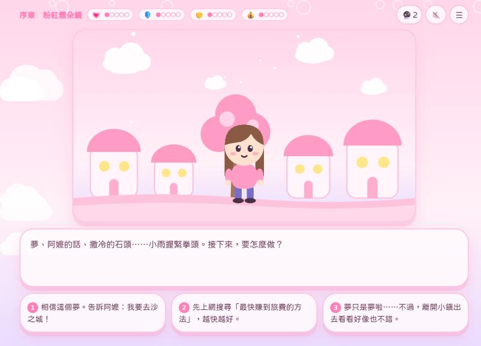
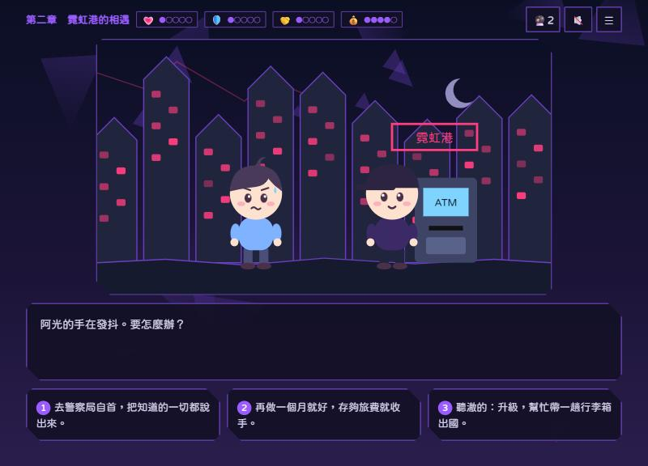
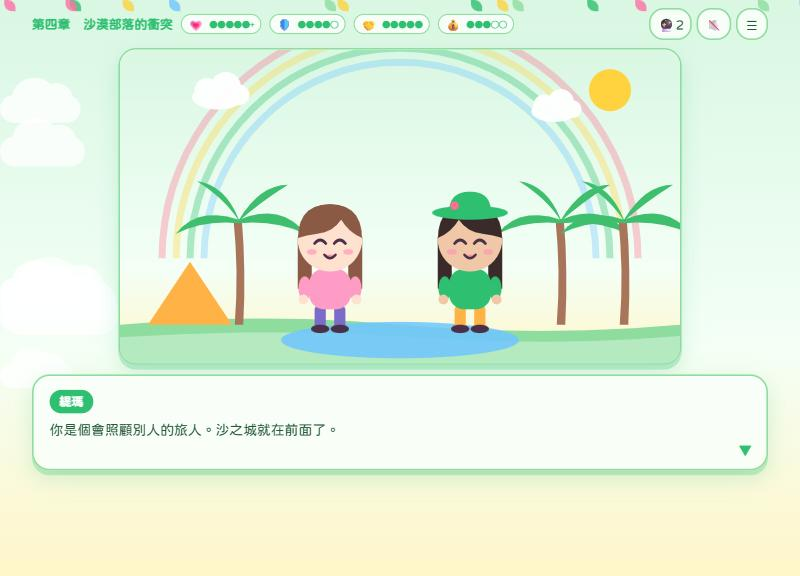
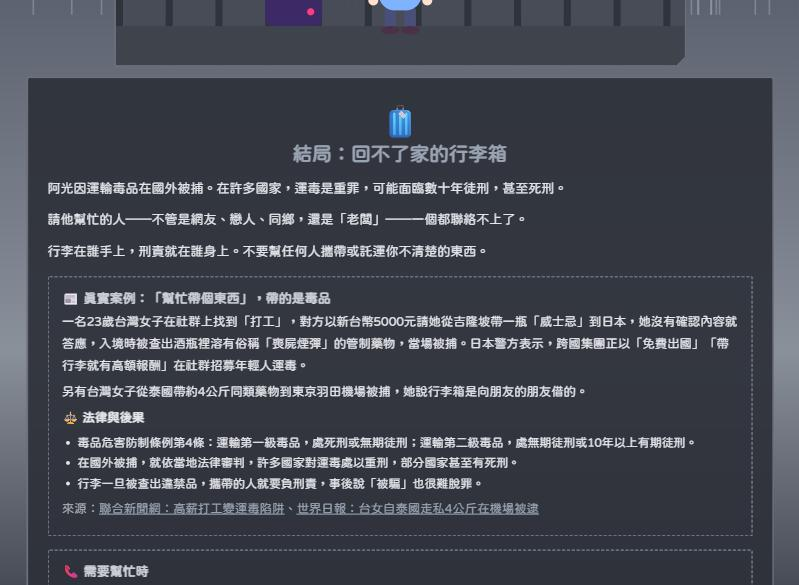

# 星之泉：It's Not Worth It

[](https://github.com/rainfunmt/it-s_not_worth_it/actions/workflows/validate.yml)


> 22 世紀 20 歲年輕人的尋寶旅程。面對真實世界的誘惑，你會怎麼選？

**[▶ 線上試玩](https://rainfunmt.github.io/it-s_not_worth_it/)**　｜　約 15–20 分鐘　｜　手機、電腦皆可　｜　繁體中文

| 粉紅夢幻（開場） | 危險（陷入誘惑） | 成長（做出好選擇） |
|---|---|---|
|  |  |  |

一款單人、選擇導向的文字冒險網頁遊戲。玩家扮演 2125 年一位 20 歲的年輕人，為了追尋夢中的「星之泉」踏上旅程，途中會遇到取材自台灣真實案例的誘惑：詐騙車手、出租帳戶、愛情詐騙、幫忙帶行李出國（運毒）、海外高薪工作、挺朋友打架、毒咖啡包。每個選擇都會改變接下來的路，以及畫面的風格。

- **適合對象：** 高中、大學生
- **用途：** 防制詐騙、毒品與暴力的宣導教材
- **故事靈感：** 保羅・科爾賀（本名 Paulo Coelho de Souza）《牧羊少年奇幻之旅》

## 特色

- 🔀 **選擇會改變選項：** 6 個轉折點都是三選一，前一個選擇決定下一組出現哪三個選項
- 📰 **取材自真實案例：** 5 種壞結局附上新聞案例、法條與法律後果，全部結局都附求助專線
- 🎨 **風格跟著選擇變：** 安全時粉紅圓角，陷入危險時轉為深色尖角，成長時轉為綠色多彩
- 🧩 **零素材、零套件：** 插畫全部用 SVG 程式繪製，音樂用 Web Audio API 即時合成，雙擊就能玩
- ✅ **自動檢查劇情：** 檢查工具會跑完全部 349 條路線，每次推送由 GitHub Actions 自動執行
- 📱 **支援手機：** 直向、橫向與小螢幕都有對應的版面

| 標題畫面 | 結局：真實案例與法律後果 | 手機版 |
|---|---|---|
|  |  |  |

## 目錄

1. [如何遊玩](#一如何遊玩)
2. [設計理念](#二設計理念)
3. [技術說明](#三技術說明)
4. [上傳到 GitHub 與線上試玩](#四上傳到-github-與線上試玩)
5. [參考資料](#五參考資料)
6. [求助專線](#六求助專線)
7. [授權](#七授權)
8. [製作名單與 AI 協作說明](#八製作名單與-ai-協作說明)

[English Summary](#english-summary)

---

## 一、如何遊玩

### 開啟遊戲
- **線上玩：** 開啟 <https://rainfunmt.github.io/it-s_not_worth_it/>，手機或電腦的瀏覽器都可以。
- **離線玩：**
  1. 雙擊資料夾裡的 `index.html`，用瀏覽器（Chrome、Edge、Firefox、Safari 皆可）開啟。
  2. 不需要安裝任何程式，也不需要網路（有網路時會載入圓體字型，沒網路會改用系統字型）。
- 手機（直向、橫向）、平板、電腦都能玩。

### 遊戲流程
1. **開始新的旅程** → 選擇主角性別（男生／女生）並輸入名字。
2. **閱讀劇情**：點一下對話框（或按空白鍵、Enter）進入下一句。
3. **轉折點三選一**：遇到轉折點時會出現三個選項，點選（或按數字鍵 1、2、3）做出決定。
4. **現實小卡**：每次做完選擇，會跳出一張「現實小卡」，說明這個情境在現實中的真實狀況。
5. **結局**：壞結局會附上真實案例與相關法律後果；所有結局都附有求助專線。

### 介面說明
| 圖示 | 功能 |
|---|---|
| 💗 心之聲 | 是否聽從自己內心，影響能否達成真結局 |
| 🛡️ 警覺 | 對詐騙的敏感度，高的時候會解鎖「先查證」等選項 |
| 🤝 羈絆 | 身邊支持你的人 |
| 💰 金幣 | 旅費 |
| 🔮 徵兆石 | 按下後再點一個選項，就能看到那個選擇背後的隱藏風險。整趟旅程只能用 **2 次** |
| 🔊 | 背景音樂開關 |
| ☰ | 選單：查看選擇路徑、回到標題 |

另外還有一個不顯示在畫面上的「🌑 陰影」數值，會隨著危險的選擇累積，影響後面出現的選項和畫面風格。

### 其他功能
- **自動存檔**：關掉瀏覽器後，從標題畫面按「繼續旅程」即可接著玩。
- **回到上一個轉折點**：在結局畫面可以回到最後一個轉折點重新選擇，鼓勵探索不同結局。
- **結局圖鑑**：收集全部 7 種結局，並可回顧已解鎖的現實小卡。
- **選擇路徑圖**：以圖表顯示你在每個轉折點看到的三個選項，以及你選了哪一個。
- **求助資源**：標題畫面可直接查看所有求助專線與本遊戲引用的案例來源。

---

## 二、設計理念

### 1. 故事架構：對照《牧羊少年奇幻之旅》
故事參考巴西作家保羅・科爾賀（本名 Paulo Coelho de Souza）的《牧羊少年奇幻之旅》，把「追尋自己的天命」放進 22 世紀：

| 原著 | 本遊戲 |
|---|---|
| 牧羊少年聖地牙哥反覆做同一個夢 | 主角反覆夢見沙之城的「星之泉」 |
| 撒冷之王送他烏陵、土明兩顆石頭 | 老機器人「撒冷」送主角兩顆徵兆石（遊戲中的提示系統） |
| 在丹吉爾被騙光旅費 | 在霓虹港被「熱心的陌生人」騙走旅費 |
| 在水晶商店工作、想出賣茶的點子 | 在水晶商店打工，提議賣「雲朵茶」 |
| 穿越沙漠、部落戰爭 | 商隊穿越沙海、綠洲的衝突（挺朋友打架） |
| 在綠洲遇見法蒂瑪 | 在綠洲遇見緹瑪，代表健康、不會要你停下腳步的感情 |
| 煉金術士的試煉 | 煉金師艾爾與慶典上的毒咖啡包 |
| 寶藏埋在出發地的無花果樹下 | 寶藏埋在家鄉棉花糖鎮的雲朵樹下 |

對照表只列出情節上的對應，遊戲中的劇情與文字均為原創改寫，沒有引用原著文字。

原著的核心是「寶藏一直在自己身上」，這正好呼應本遊戲的主題：**真正珍貴的，是在每個誘惑面前守住自己，以及身邊陪伴你的人。** 遊戲名稱「It's Not Worth It」就是想告訴玩家：快錢、甜言蜜語、一時的義氣，都不值得拿人生去換。

### 2. 誘惑設計：取材自真實案例
每一種誘惑都對應台灣近年真實發生、有新聞或官方資料可查的案例：

| 章節 | 誘惑 | 對應的真實手法 |
|---|---|---|
| 第一章 啟程的旅費 | 「日領 5000，收包裹、去 ATM 領錢」、「帳戶出租月領 2 萬」 | 詐騙車手、取簿手、人頭帳戶 |
| 第二章 霓虹港的相遇 | 交友軟體上完美但不肯視訊的對象，介紹投資平台 | 假交友投資詐騙（殺豬盤） |
| 第三章 一只行李箱 | 同鄉、網友或「老闆」請你幫忙帶行李出國；海外高薪工作 | 運毒「人肉快遞」、柬埔寨詐騙園區 |
| 第四章 沙漠部落的衝突 | 朋友被欺負，群組號召「帶傢伙去討回公道」 | 刑法第 150 條妨害秩序罪（在場助勢也觸法） |
| 第五章 煉金術士的試煉 | 派對上包裝可愛的「星星咖啡包」 | 毒咖啡包、新興毒品 |

設定在 22 世紀，是為了讓玩家看見：**一百年過去了，騙術換了新衣服，骨子裡卻一模一樣。** 腕環、全像投影、磁浮商隊都是新的，但「高薪、免經驗、只要領錢」的話術和今天完全相同。

### 3. 選擇設計：三選一，且前一個選擇決定下一組選項
- 每個轉折點固定三個選項，通常是 **成長**（健康的選擇）、**灰色**（沒做錯，但也沒做得更多）、**危險**（踏進陷阱）。陷入危險後，會出現 **回頭** 的選項（自首、報警、求助）。
- **選項會依前面的選擇改變**。例如：
  - 在序章選擇「上網搜尋最快賺錢的方法」，第一章就會看到更多快錢誘惑。
  - 第一章去水晶店打工，第二章遇到的是愛情詐騙；去當車手，第二章遇到的是「自首、繼續做、升級帶貨」。
  - 警覺值夠高時，才會出現「視訊、以圖搜圖、打 165 查證」的選項。
  - 陰影值累積太多時，挺朋友的情境會變成朋友直接塞給你甩棍，慶典上的誘惑也會變成「喝了就能忘掉一切」。
- 遊戲刻意讓每個選擇都 **合理、現實中真的可能這樣選**：危險選項不寫成明顯的壞事，而是像真實情境一樣「看起來很划算」「只是幫個忙」「只試一次」。
- 危險的選擇不一定馬上 Game Over。陷進去之後仍有回頭的機會，因為現實中停損永遠不嫌晚；回頭後也必須承擔後果（開庭、緩起訴、賠償），而不是一筆勾銷。

### 4. 視覺風格：風格跟著選擇改變
畫面全部以程式繪製的可愛插畫風呈現，並依劇情與選擇切換六種主題：

| 主題 | 出現時機 | 風格 |
|---|---|---|
| 粉紅夢幻 | 開場、家鄉 | 粉紅、奶油、薰衣草色，軟綿綿的雲、圓角房子、泡泡 |
| 危險 | 陷入誘惑 | 深藍、黑、灰、闇紫，尖角碎片、鋸齒屋頂、霓虹裂痕 |
| 成長 | 做出成長的選擇 | 綠色加上彩虹點綴，葉子、花、星星 |
| 沙漠旅途 | 中立的冒險段落 | 暖沙金、夕陽橘、沙丘、駱駝商隊 |
| 曙光 | 回頭、求助、真結局 | 金橘色晨光、放射光芒 |
| 灰燼 | 壞結局 | 去飽和的灰色、雨、鐵窗線條 |

同一個地點會隨主題變形：家鄉的圓頂房子，在危險主題下會變成歪斜的尖屋頂。所有卡片、按鈕也會從圓角變成尖角。愛情詐騙的場景刻意維持粉紅夢幻風格，表現「陷阱往往看起來很甜」。背景音樂也會跟著主題切換。

### 5. 結局設計（共 7 種）
| 結局 | 達成方式（提示） | 對應的案例卡 |
|---|---|---|
| 🌟 自己的傳說 | 一路聽從心之聲，並在別人需要時伸出手 | — |
| 🌤️ 平凡的安全 | 平安回家，但有些時候選擇了沉默 | — |
| ⛓️ 鐵窗裡的旅費 | 想用最快的方法賺到旅費 | 詐騙車手、人頭帳戶 |
| 🧳 回不了家的行李箱 | 只是幫忙帶個東西而已 | 運毒 |
| 💔 人財兩失 | 為了愛，也為了把錢賺回來 | 愛情詐騙、海外詐騙園區 |
| 🗡️ 一時義氣 | 兄弟有難，怎麼能不挺？ | 妨害秩序 |
| 🌀 深淵 | 只試一次，應該沒關係吧？ | 毒咖啡包 |

壞結局不是為了懲罰玩家，而是讓玩家在安全的遊戲裡「先看見後果」。5 種壞結局都附上真實案例與法律後果，所有結局都附有求助管道，並可回到上一個轉折點重新選擇。

### 6. 教育設計原則
- **不責怪受害者**：愛情詐騙結局強調「被騙不是你的錯，越早報案越有機會追回」。
- **不渲染犯罪與毒品**：不描寫毒品使用細節，著重在後果與求助。
- **案例去識別化**：只摘要新聞與官方資料，不使用任何當事人姓名。
- **提供實際求助管道**：每個結局都附上相關專線。

---

## 三、技術說明
- 純 HTML、CSS、JavaScript，免建置、免安裝，雙擊即可執行。
- 插畫全部用 SVG 以程式繪製，背景音樂與音效用 Web Audio API 即時合成，沒有使用任何外部圖片或音樂素材。字型使用 Google Fonts 的「粉圓體」（SIL Open Font License）。
- 進度與結局收集存在瀏覽器的 localStorage（無痕模式下可能無法存檔，但仍可正常遊玩）。
- 版面支援手機直向、橫向（插畫與對話並排）與桌面，插畫依螢幕高度縮放，永遠完整顯示。

### 檔案結構
```
index.html                     遊戲主頁面
css/style.css                  六種主題的顏色與形狀、版面、動畫
js/story.js                    全部劇情、轉折點、選項與結局
js/cases.js                    真實案例、法律後果、現實小卡、求助專線
js/scenes.js                   SVG 插畫（場景、角色、道具）
js/audio.js                    背景音樂與音效合成
js/state.js                    遊戲狀態與存檔
js/engine.js                   劇情引擎（對話、選項、主題切換）
js/ui.js                       介面（圖鑑、路徑圖、彈窗）
tools/validate.js              劇情檢查工具
.github/workflows/validate.yml GitHub Actions：每次推送自動執行劇情檢查
docs/screenshots/              README 用的遊戲截圖
.nojekyll                      讓 GitHub Pages 直接提供檔案，不經過 Jekyll 處理
```

### 劇情檢查
修改劇情後，可以用 Node.js 執行檢查工具，確認每條路線都沒有斷掉、每個轉折點在任何狀態下都剛好三個選項、7 種結局都能達成：
```bash
node tools/validate.js
```
目前的檢查結果：59 個劇情節點、6 個轉折點、349 條完整路線，全部通過。

上傳到 GitHub 後，每次推送都會由 GitHub Actions 自動執行這個檢查，結果顯示在 README 最上方的「劇情檢查」徽章。

### 如何修改劇情
劇情資料和遊戲程式是分開的，要改台詞或選項只需要改 `js/story.js`，不用動程式。每個轉折點的格式如下：
```js
tp1: {
  ch: 1, tp: 'tp1', theme: 'dream',            // 章節、轉折點代號、畫面主題
  scene: { place: 'room', chars: [hero('normal', 300)] },
  prompt: '要怎麼湊到旅費？',
  sets: [                                      // 依前面的選擇挑一組選項（每組固定 3 個）
    { when: s => s.flags.fast, options: [ /* 3 個選項 */ ] },
    { options: [ /* 預設的 3 個選項 */ ] }
  ]
}
```
每個選項可以設定 `effects`（數值變化）、`flags`（記錄選過什麼）、`omen`（徵兆石揭露的風險）與 `next`（下一個劇情節點）。改完後執行 `node tools/validate.js` 確認沒有出錯。

---

## 四、上傳到 GitHub 與線上試玩

<details>
<summary><b>第一次上傳的步驟</b>（點開查看）</summary>

Repository：<https://github.com/rainfunmt/it-s_not_worth_it>

GitHub 上的 repository 建立時已經自動產生一個 commit（含一份 MIT LICENSE），所以第一次上傳要先把它合併進來，再推上去。在專案資料夾依序執行：

```bash
git init
```
```bash
git add .
```
```bash
git commit -m "星之泉：It's Not Worth It"
```
```bash
git branch -M main
```
```bash
git remote add origin https://github.com/rainfunmt/it-s_not_worth_it.git
```
```bash
git pull origin main --allow-unrelated-histories --no-rebase
```
這一步會因為兩邊都有 `LICENSE` 而出現衝突。保留本專案的雙重授權版本：
```bash
git checkout --ours LICENSE
```
```bash
git add LICENSE
```
```bash
git commit -m "合併 GitHub 上的初始 commit"
```
```bash
git push -u origin main
```

**開啟 GitHub Pages（線上試玩）**

1. 到 repository 的 **Settings → Pages**。
2. **Source** 選 **Deploy from a branch**，Branch 選 **main**、資料夾選 **/(root)**，按 **Save**。
3. 等 1～2 分鐘，就能從 <https://rainfunmt.github.io/it-s_not_worth_it/> 開啟遊戲。

</details>

---

## 五、參考資料

### 文學作品
- 保羅・科爾賀（本名 Paulo Coelho de Souza）。《牧羊少年奇幻之旅》（*O Alquimista* / *The Alchemist*），1988。
  - 作者為巴西作家，以葡萄牙文寫作；「保羅・科爾賀」為台灣通行譯名。
  - 本遊戲的故事架構受此書啟發，所有劇情與文字均為原創改寫。遊戲標題畫面標有「故事靈感：保羅・科爾賀（本名 Paulo Coelho de Souza）《牧羊少年奇幻之旅》」。
  - 遊戲中的「烏陵、土明」與「撒冷」出自《聖經》；「千里尋寶，最後發現寶藏在自己家」是古老的民間故事母題（如《一千零一夜》中因夢致富的故事、英國民間故事〈斯瓦夫漢姆的小販〉）。

### 詐騙車手、人頭帳戶
- TVBS 報導，經 Cofacts 真的假的查核引用：大學生應徵「領包裹」打工，發現內有多張提款卡。<https://en.cofacts.tw/reply/1orXFYMBv5it-Cx_0pUm>
- newtalk 轉載中央社（2025-08-27）：屏東大學周邊 ATM 車手提領，警方逮捕 17 名車手與幹部。<https://newtalk.tw/news/view/2025-08-27/990279>
- 1111 人力銀行：求職被騙當車手，打工打入牢獄中。<https://www.1111.com.tw/news/jobns/147607>
- 法務部說明（農業部網站轉載）：洗錢防制法「無正當理由交付、提供帳戶」規定與告誡制度。<https://www.moa.gov.tw/ws.php?id=2515304>
- 1111 人力銀行：法務部針對人頭帳戶擬洗錢防制法修正草案。<https://www.1111.com.tw/news/jobns/150892>

### 愛情詐騙、假投資
- newtalk（2025-08-11）：165 打詐儀錶板最新統計，假投資與假交友投資詐財占比。<https://newtalk.tw/news/view/2025-08-11/987098>
- 聯合新聞網：詐騙最新統計公布，假投資財損仍居首。<https://udn.com/news/story/124490/8948666>

### 海外高薪工作、詐騙園區
- 1111 人力銀行：9 月仍有逾千人赴柬埔寨，外交部多方合作協助國人返台。<https://www.1111.com.tw/news/jobns/148523>
- 台灣英文新聞：柬埔寨詐騙集團以高薪誘騙台灣人。<https://www.taiwannews.com.tw/zh/news/4616302>
- 台灣事實查核中心：小心「海外打工誘騙」事件，5 招積極防範。<https://tfc-taiwan.org.tw/articles/8034>

### 運毒
- 聯合新聞網：高薪打工變運毒陷阱，台灣女子攜「喪屍煙彈」闖日本遭逮。<https://udn.com/news/story/6810/9765244>
- 世界日報：台女自泰國走私 4 公斤「喪屍煙彈」在羽田機場被逮。<https://www.worldjournal.com/wj/amp/story/121488/9449777>

### 妨害秩序（聚眾鬥毆）
- 公視新聞網：政院拍定修法草案，3 人以上就算「聚眾」。<https://news.pts.org.tw/article/425530>
- 法務部彰化地檢署講座資料（國立臺灣大學許恒達教授）：刑法第 149、150 條修正後的實務。<https://www.chc.moj.gov.tw/media/278064/主講人-國立臺灣大學教授許恒達.pdf>

### 毒咖啡包
- 公視新聞網：強力搖頭丸再度襲台，3 個月內已奪 34 命。<https://news.pts.org.tw/article/463798>
- 報導者：毒咖啡包是什麼？<https://www.twreporter.org/a/mini-reporter-coffee-bag-drugs>

### 法規
- 中華民國刑法第 150 條（妨害秩序罪）、第 339 條之 4（加重詐欺罪）
- 洗錢防制法（無正當理由交付、提供帳戶之處罰）
- 毒品危害防制條例第 4 條（運輸毒品）、第 10、11 條及第 11 條之 1（施用與持有毒品）

法規內容以[全國法規資料庫](https://law.moj.gov.tw/)現行條文為準。

> 以上案例與數據查證日期為 2026-10-25。新聞報導的數字依發布時間與統計方式可能不同，引用時請以原始來源為準。

---

## 六、求助專線
| 專線 | 名稱 | 用途 |
|---|---|---|
| 110 | 報案專線 | 遇到詐騙、威脅、暴力或犯罪 |
| 165 | 反詐騙諮詢專線 | 不確定是不是詐騙，先打 165 問 |
| 119 | 緊急救護 | 有人疑似藥物中毒、受傷 |
| 1925 | 安心專線（依舊愛我） | 衛福部 24 小時免費心理諮詢 |
| 0800-770-885 | 戒毒成功專線（請請你幫幫我） | 24 小時毒品危害諮詢與戒治資源轉介 |
| 1957 | 福利諮詢專線 | 經濟困難時的政府協助資源 |
| 800-0885-0885 | 外交部旅外國人急難救助專線 | 在國外遇到急難（撥打方式依所在國家而定） |

---

## 七、授權
- **程式碼**（`.html`、`.css`、`.js`）：[MIT License](LICENSE)，歡迎學習、修改與再利用。
- **劇情文字、角色設定與插畫設計**：[CC BY-NC 4.0](https://creativecommons.org/licenses/by-nc/4.0/deed.zh-hant)（姓名標示─非商業性），可非商業使用，但須標示出處。
- **真實案例摘要**（`js/cases.js`）：改寫自所列新聞與官方資料，原始內容的權利屬於各來源，引用時請連回原始出處。

詳細條款見 [LICENSE](LICENSE)。

---

## 八、製作名單與 AI 協作說明

### 製作名單
- 企劃、劇情與製作：rainfunmt
- 程式、劇情草稿與資料查證：使用 AI 工具（Claude）協助完成，並經人工檢閱與修改

### AI 協作說明
本專案在開發過程中使用 AI 工具（Anthropic 的 Claude）協助。為了誠實說明作品的完成方式，以下列出分工：

**由作者決定與完成**
- 遊戲主題與教育目的：以真實誘惑案例為題材的防制宣導遊戲
- 核心設計需求：20 歲主角可選性別、誘惑類型（愛情陷阱、帶東西出國、挺朋友打架、毒品）、每個轉折點三選一且前一個選擇影響下一組選項、以《牧羊少年奇幻之旅》為故事架構
- 視覺方向：開場粉紅夢幻、危險時轉為深色尖角、成長時轉為綠色多彩
- 規格決定：網頁遊戲、遊戲長度、目標對象，以及音樂、存檔、數值系統、路徑圖等功能
- 審閱與修正：檢查原著引用的著作權疑慮並決定修改方向、確認作者譯名與標示方式、要求檢查手機版面

**由 AI 協助完成，並經作者審閱**
- 程式架構與程式碼（劇情引擎、SVG 插畫、音樂合成、版面）
- 劇情與台詞初稿
- 真實案例、法條與求助專線的搜尋與整理（附原始來源連結）
- 劇情檢查工具與手機版面測試

**品質把關**
- 所有案例皆附新聞或官方來源連結，可供查證
- 以自動檢查工具驗證全部 349 條劇情路線
- 在電腦上試玩全部 7 種結局，並在手機直向、橫向與小螢幕尺寸檢查版面

---

## English Summary

**Star Spring: It's Not Worth It** is a single-player, choice-driven web game about real-world temptations young people face. In the year 2125, a 20-year-old leaves a soft, pink cloud town to chase a dream, a journey inspired by Paulo Coelho's *The Alchemist*. Along the way the player meets temptations based on real cases from Taiwan: scam "money mule" jobs, renting out bank accounts, romance-investment scams, carrying luggage abroad (drug smuggling), fake overseas jobs, gang fights, and drug-laced "coffee packs".

- 6 turning points, each with 3 choices; earlier choices change the next set of options
- 7 endings: the 5 bad endings each show a real news case and the legal consequences, and every ending lists Taiwan help hotlines
- The art style shifts with the player's choices: pink and rounded when safe, dark and spiky in danger, green and colorful when growing
- Pure HTML/CSS/JavaScript with no build step and no external assets: all art is drawn in SVG by code, and the music is synthesized live with the Web Audio API
- An automated checker (`tools/validate.js`, run by GitHub Actions) walks all 349 story paths to make sure every turning point has exactly 3 options and every ending is reachable

The game text is in Traditional Chinese.

**[▶ Play online](https://rainfunmt.github.io/it-s_not_worth_it/)**
